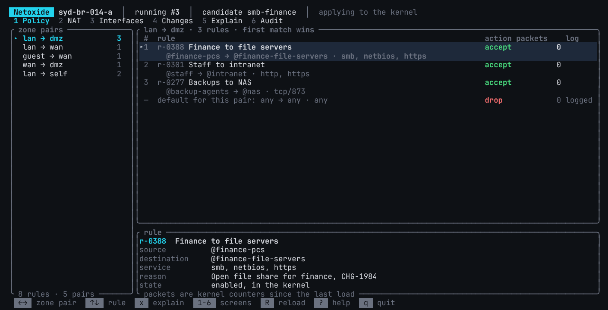
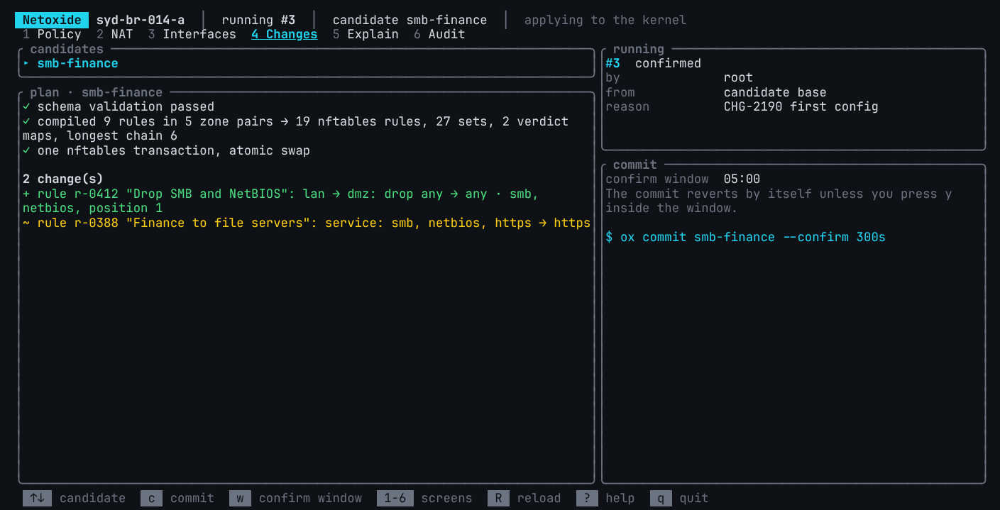
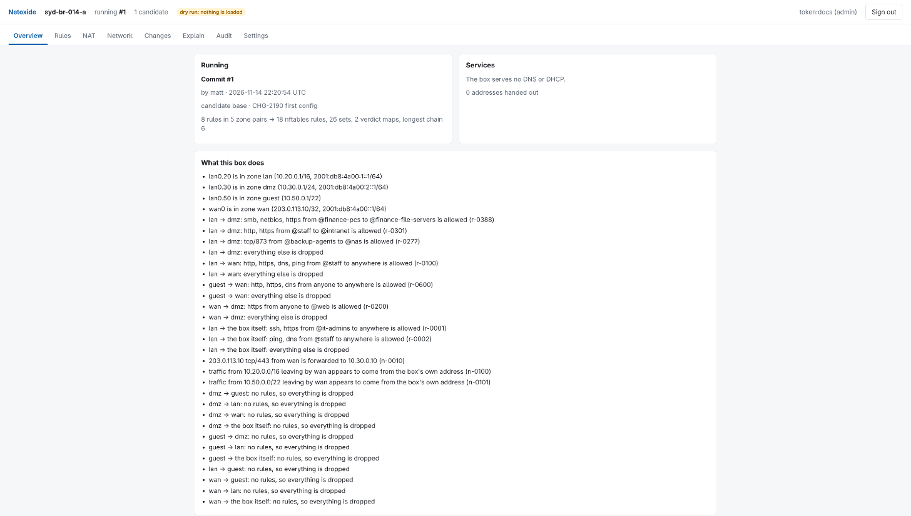
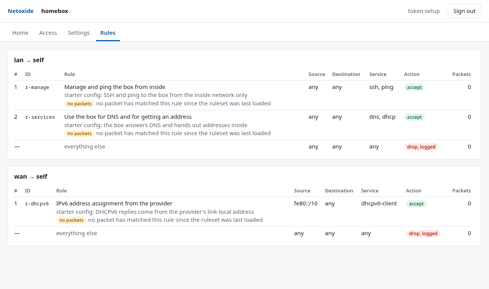
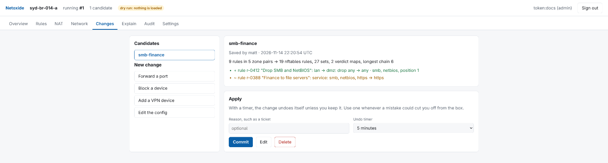

# Netoxide

Netoxide is an open-source firewall and router for Linux with a control plane written in Rust. You describe the box in one typed config file. A daemon applies it to the kernel through nftables as a transaction that undoes itself if you lock yourself out.

It is meant for two groups: home-lab users who want one box that is quick to set up, and teams that run 10 to 300 firewalls across sites, mostly people moving off pfSense or OPNsense.

**Status: 0.1.0, a preview.** It is a working single-box firewall and router that passes its tests in network namespaces and in a virtual machine under systemd. It has never run on real hardware, and nobody outside the project has audited it. Do not put it in front of a network you care about yet. See [what works and what does not](docs/status.md).

- [In the terminal](#in-the-terminal)
- [In the browser](#in-the-browser)
- [What it does](#what-it-does)
- [Try it in two minutes](#try-it-in-two-minutes)
- [Install on a box](#install-on-a-box)
- [Who it is for](#who-it-is-for)
- [Limits](#limits)
- [How the code is written](#how-the-code-is-written)
- [Documents](#documents)
- [Licence and name](#licence-and-name)

## In the terminal

`netoxide-tui` is a full-screen terminal interface. Everything on screen comes from the daemon and is read again once a second.



The Policy screen lists zone pairs and their rules, with the kernel's packet counter beside each rule. Press `x` on a rule to see what it does to a packet.



The Changes screen shows what a proposed config would change before you apply it. A commit from here always has an undo timer: press `y` to keep it, or do nothing and the box goes back by itself.

| Screen | Shows |
| --- | --- |
| Policy | Zone pairs and rules, with packet counts |
| NAT | Port forwards and outbound NAT |
| Interfaces | Interfaces, zones and addresses |
| Changes | Candidates, the plan for one, commit with an undo timer |
| Explain | A packet you type, judged by the running config and a candidate side by side |
| Audit | The audit log, newest first |

The same tool works over SSH on the box or from your own machine with `--remote`. The command line tool `ox` does everything the screens do, and more:

```sh
ox init --save starter                 # guided setup: which port faces the internet?
ox commit starter --confirm 5m         # apply; undoes itself unless you run `ox confirm`
ox forward --name web --port tcp/443 --to 192.168.10.20
ox block 192.168.10.66 --name "Smart TV"
ox vpn add laptop --endpoint home.example.net
ox explain --src 192.168.10.50 --dst 1.1.1.1 --proto tcp --dport 443 --in eth1
```

Keys and every screen are in [docs/interfaces.md](docs/interfaces.md). Every command is in [docs/reference.md](docs/reference.md).

## In the browser

The daemon serves a web interface over HTTPS. It is three static files compiled into the daemon, with no build step and nothing loaded from elsewhere.



The Overview says what the box does in plain sentences, generated from the running config.



Rules shows every zone pair with its rules and the default at the bottom of each.



Changes is where you forward a port, block a device, add a VPN device or edit the whole config. Each one becomes a candidate with its plan, and you commit it with an undo timer.

There are also pages for NAT, the network and the addresses handed out, explaining a packet, the audit log, and settings for access tokens and roles. The pictures were taken against a daemon in dry-run mode, which is why the header says nothing is loaded and the packet counts are empty.

## What it does

- **Firewall and NAT.** Rules are written between zones, for IPv4 and IPv6 together. Port forwards and outbound NAT. Compiled to nftables sets and verdict maps and loaded as one atomic transaction.
- **Safe changes.** Every change is a named candidate. `ox plan` shows what it would change. A commit with a confirm window reverts by itself unless you confirm it. Rollback is one command, and every action is in a hash-chained audit log.
- **Explain.** Ask what happens to one packet and get the rule that decides, under the running config or a candidate that is not applied yet.
- **A whole router.** DNS with DNSSEC checking, DHCP, IPv6 announcements, an internet-side address from the provider by DHCP, interface addresses and routes.
- **VPN.** WireGuard through the kernel's own implementation. One command adds a phone or laptop and prints its config.
- **Access control.** Access tokens with roles. A role can be held to parts of the config, so a network admin cannot change firewall rules. A commit can require a second person's approval.
- **Remote management.** `ox --remote <name>` manages a box over HTTPS, with the box's certificate pinned by fingerprint as SSH does with host keys.
- **Import.** Translates a pfSense backup into a config and checks its own translation.
- **Monitoring.** Prometheus metrics, and a report of rules that never apply, add nothing or allow everything.

The full list, with how each piece was tested, is in [docs/status.md](docs/status.md).

## Try it in two minutes

This runs the daemon in a private, rootless network namespace. It loads rules into that namespace's kernel tables and cannot touch your machine's own.

You need Rust 1.88 or later, `libnftables.so.1` (the `nftables` package), `unshare` from util-linux, and a kernel that allows unprivileged user namespaces.

```sh
cargo build
export OX_SOCKET=/tmp/oxd.sock
unshare -Urn ./target/debug/oxd --state-dir /tmp/ox-state --socket $OX_SOCKET &
alias ox=./target/debug/ox

ox candidate save base examples/branch.toml
ox commit base --reason "first config"

ox candidate save block-legacy-smb examples/branch-candidate.toml
ox plan block-legacy-smb
ox commit block-legacy-smb --confirm 30s --reason CHG-2207
```

Now wait 30 seconds. `ox status` shows commit #1 running again, because nobody confirmed the change. Then open the terminal interface on the same daemon:

```sh
cargo run -p netoxide-tui --release -- --socket $OX_SOCKET
```

**Warning.** Outside a namespace, `oxd` replaces the host's `netoxide` nftables table, and the default is to drop. Use `oxd --dry-run` if you want the API and the interfaces without loading anything.

[docs/getting-started.md](docs/getting-started.md) continues from here: the guided setup, forwarding a port and blocking a device.

## Install on a box

[dist/README.md](dist/README.md) has the steps for a Linux machine with systemd: install the binaries and the unit, first start, the web interface, lockdown, monitoring and removal. A test boots a virtual machine and runs those steps on every run. Nobody has run them on hardware yet.

There is no installer and no OS image. You install Netoxide on an existing Linux machine, and that machine's own network manager must leave the ports you give to Netoxide alone.

## Who it is for

- **Home-lab users and small offices** running one box, who want a firewall that is quick to set up, clear about what it is doing, and free in full.
- **Teams and service providers** running 10 to 300 firewalls, who want config as code, safe changes, an audit trail and fleet management. The fleet parts are planned and not built.

The design rule is "easy first, advanced within reach". Each area has an easy path and an advanced path over the same config, so `ox init` and the one-step commands write ordinary config that the advanced tools can read and change. Nothing a single box needs depends on a controller, a login server or a fleet feature.

The research behind the project is in [docs/research/market-gap.md](docs/research/market-gap.md). It found no buyer asking for Rust by name. Rust is here for two reasons: a control plane that never builds a shell command, and memory-safe code on the network-facing side. Packets stay in the Linux kernel, and this project makes no performance claim.

## Limits

The short version. The full list is in [docs/status.md](docs/status.md#limits-today).

- It has never run on real hardware or carried real traffic. The furthest it has been is a virtual machine on one developer's computer, with SELinux off.
- Nobody outside the project has reviewed the security of any of it.
- The daemon creates VLAN interfaces. It does not create bridge, bond or PPPoE interfaces; the operating system still does.
- No IPv6 prefix delegation, no multi-WAN, no routing protocols, no traffic shaping, no intrusion detection, no high availability.
- The VPN is WireGuard only. It has been tested between two Netoxide boxes, not against the official WireGuard apps.
- No single sign-on. Access is by token.
- No fleet controller, Terraform provider or OS image.

## How the code is written

Most of the code, tests and documentation here were written by an AI coding assistant, Claude, working under the direction of one human maintainer who decides what gets built and merges it. Commits made that way carry a `Co-Authored-By` trailer.

A second person has not reviewed it line by line, and there has been no outside security audit. What stands in for that today is in the repository for you to check: 164 tests, including ones that send real packets through the kernel and compare the result with what the firewall says it will do, a virtual machine test of the installed system, and two internal review passes whose findings are fixed with tests. That is evidence, and it is not the same as an audit. The [threat model](docs/threat-model.md) says where to look first.

There is no AI on the box. The firewall does not call a model, send data anywhere, or include an assistant.

## Documents

| | |
| --- | --- |
| [docs/getting-started.md](docs/getting-started.md) | Try it in a namespace, then set a box up from nothing |
| [dist/README.md](dist/README.md) | Install on a machine with systemd |
| [docs/config.md](docs/config.md) | The config file, how a change reaches the kernel, explain, pfSense import |
| [docs/interfaces.md](docs/interfaces.md) | The terminal UI and the web UI, screen by screen |
| [docs/access.md](docs/access.md) | Managing a box from another machine, tokens and roles |
| [docs/reference.md](docs/reference.md) | Every command and every API route |
| [docs/status.md](docs/status.md) | What works, the limits, and what is not built |
| [docs/roadmap.md](docs/roadmap.md) | What comes next, in what order, and what stays free |
| [docs/threat-model.md](docs/threat-model.md) | What it is built to resist, what it relies on, and what it does not defend against |
| [docs/recovery.md](docs/recovery.md) | What to do if a change locks you out |
| [docs/architecture.md](docs/architecture.md) | The crates, the design rules and the tests |
| [CHANGELOG.md](CHANGELOG.md) | What each release changed |
| [SECURITY.md](SECURITY.md) | How to report a vulnerability |
| [CONTRIBUTING.md](CONTRIBUTING.md) | How to build, test and send a change |
| [docs/releasing.md](docs/releasing.md) | How a version goes out, and what blocks the first one |
| [docs/spec.md](docs/spec.md) | The product spec: scope, non-goals and open questions |
| [docs/design/](docs/design/README.md) | The web UI design and a browser preview of the terminal UI |

## Licence and name

**No licence has been chosen**, so this repository carries none and nobody may yet use, copy or distribute the code. The choice on the table is AGPL-3.0-or-later for the daemon and tools with Apache-2.0 for the schema and client libraries, or Apache-2.0 throughout.

"Netoxide" is a working name. It has not been checked for trademark conflicts, and it sits close to Oxide Computer Company, which also builds networking products in Rust.
