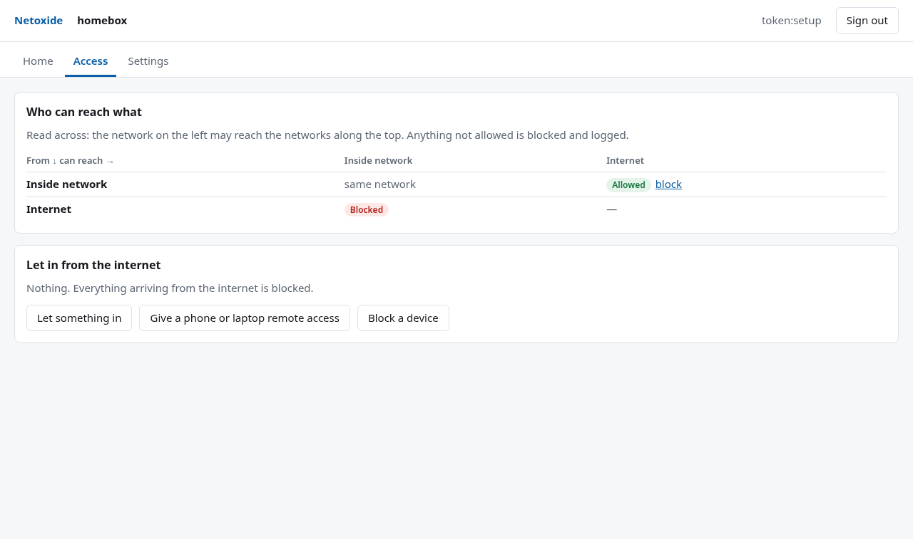

# Netoxide

**A Linux firewall and router that makes network policy clear.**

Netoxide is an open-source firewall and router that brings network access, DNS, DHCP and VPN management into one configuration. Define which networks can reach each other, review what a change will do, and apply it with automatic rollback. Manage the box through a browser, an SSH-friendly terminal interface, or the command line.

Built for home labs first, Netoxide makes everyday tasks straightforward while keeping detailed rules and configuration available when you need them. Its Rust control plane compiles firewall policy into nftables rules enforced by the Linux kernel.

**0.1.1 preview — available for lab evaluation.** Validated in network namespaces and a systemd VM, with automated CLI, terminal and browser checks. Hardware validation, broader user testing and an independent security audit are still ahead; production use is outside the current release scope. [Release status and supported scope](docs/status.md).


*Create a guest network, review the change, and check which connections are allowed—all from the terminal.*

## What you can do

- **Control access between networks.** IPv4 and IPv6 firewall rules, NAT and port forwards, with firewall rules loaded in one atomic transaction.
- **Run your home-lab router.** DNS, DHCP, VLANs, IPv6 router announcements and WireGuard VPN access in the same configuration.
- **Review and confirm changes.** See the proposed change in plain language. `ox apply` rolls it back after two minutes unless you confirm with `ox keep`; advanced commits support a configurable confirmation window.
- **Complete everyday tasks directly.** Add a guest network, forward a service, block a device or domain, or connect a phone to the VPN.
- **Understand a connection's outcome.** Check a packet against the configuration to see the verdict and the rule that decides it, including changes you have not applied yet.
- **Manage and inspect the box.** Role-based access tokens, configuration history, an audit log, Prometheus metrics and a pfSense configuration importer.

## Three interfaces, one configuration

Choose the interface that fits the task. The browser and terminal start with everyday tasks; detailed screens are available in Settings. The CLI exposes both everyday and advanced operations.

| Interface | Use it for |
| --- | --- |
| **Terminal** | Manage the box over SSH with `netoxide-tui`. Its everyday screens fit an 80×24 terminal. |
| **Browser** | Set up a new box using its console code, manage network access, and review changes over HTTPS. |
| **Command line** | Use `ox --help` for everyday commands and `ox more` for advanced configuration, inspection and automation. |



*The Access grid shows which networks can reach each other. Review and apply changes before they take effect.*

On a configured box, adding a guest network follows the same review-and-confirm workflow:

```sh
ox network add "Guest Wi-Fi" --port eth1 --vlan 20
ox apply                 # print the plan and apply with a two-minute rollback window
ox keep                  # confirm after checking the result
```

See [the interfaces](docs/interfaces.md) for screen capabilities and [the command reference](docs/reference.md) for all commands and API routes.

## Try it locally

Run the daemon in a private, rootless network namespace to explore the configuration and interfaces without changing your host's firewall. You need Linux, Rust 1.88 or later, `nftables`, `unshare` from util-linux, and permission to create unprivileged user namespaces.

```sh
git clone https://github.com/matthart1983/netoxide.git
cd netoxide
cargo build
export OX_SOCKET=/tmp/oxd.sock
unshare -Urn ./target/debug/oxd --state-dir /tmp/ox-state --socket "$OX_SOCKET" &
```

Once the daemon prints `oxd: listening`, load the example configuration and open the terminal interface:

```sh
./target/debug/ox candidate save demo examples/branch.toml
./target/debug/ox apply demo
./target/debug/ox keep
./target/debug/netoxide-tui --live
```

The terminal opens against the daemon with the example configuration loaded. This namespace demo lets you inspect policy; it does not connect your physical networks. [Getting started](docs/getting-started.md) covers planning changes, testing rollback and setting up a box.

## Install on a lab box

On an x86-64 Linux machine with systemd, download the package for your distribution from the [latest release](https://github.com/matthart1983/netoxide/releases):

```sh
sudo apt install ./netoxide_*_amd64.deb      # Debian 12 or later, Ubuntu 22.04 or later
sudo dnf install ./netoxide-*.x86_64.rpm     # Fedora, RHEL 9 and its rebuilds
```

Installing starts the daemon. Run `ox status` for the setup code, then open `https://<the box>:8443/` in a browser. On other distributions, unpack the release archive and run `sudo sh dist/install.sh --packages`. Use a dedicated lab machine or VM with console access: Netoxide manages its network interfaces and firewall. The installation guide covers existing network-manager conflicts and removal.

[Installation guide](dist/README.md) · [Proxmox guide](docs/proxmox.md) · [Recovery](docs/recovery.md)

## Development

Netoxide is maintained by one developer using Claude for most implementation, tests and documentation. The maintainer directs development and merges changes. AI is used during development only; Netoxide has no runtime model or AI service dependency.

Validation includes kernel packet tests, automated browser and terminal workflows, and an installed-system VM test covering networking, rollback, restart and recovery. See [architecture and testing](docs/architecture.md) for coverage and [the threat model](docs/threat-model.md) for security assumptions.

The current focus is one-box lab deployments. Multi-WAN, routing protocols, traffic shaping, intrusion detection, high availability and fleet management are future work. [Roadmap](docs/roadmap.md).

Hardware test reports, usability feedback and focused fixes are welcome. [Contributing](CONTRIBUTING.md).

## Documentation

- **Start:** [getting started](docs/getting-started.md) · [install](dist/README.md) · [Proxmox](docs/proxmox.md)
- **Use:** [the interfaces](docs/interfaces.md) · [the config file](docs/config.md) · [remote access, tokens and roles](docs/access.md) · [every command and API route](docs/reference.md)
- **Status and security:** [release status](docs/status.md) · [threat model](docs/threat-model.md) · [recovery](docs/recovery.md) · [reporting a vulnerability](SECURITY.md)
- **Project:** [roadmap](docs/roadmap.md) · [architecture and tests](docs/architecture.md) · [changelog](CHANGELOG.md) · [contributing](CONTRIBUTING.md) · [releasing](docs/releasing.md) · [design](docs/design/README.md)

## Licence

MIT. See [LICENSE](LICENSE).
