# The terminal UI and the web UI

Both show the same daemon. Use whichever you like; they can be open at once.

- [The terminal UI](#the-terminal-ui)
- [The web UI](#the-web-ui)

## The terminal UI

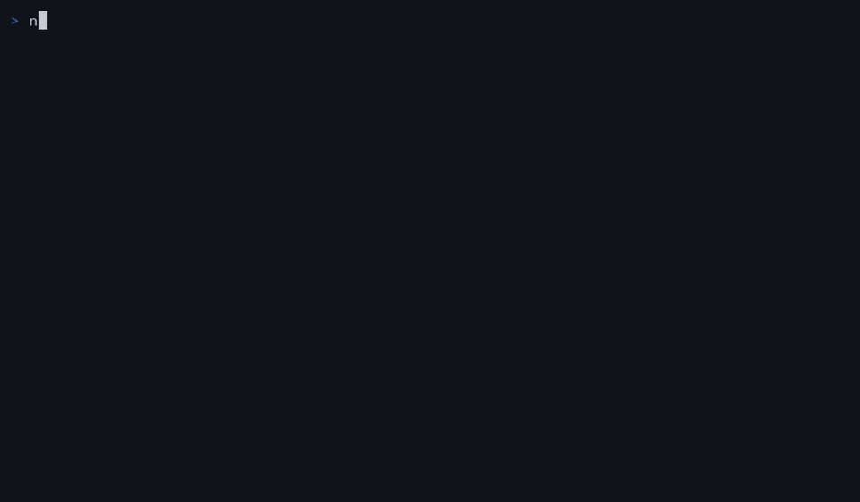

```sh
netoxide-tui --live                 # on the box
netoxide-tui --remote <name>        # from another machine, a box saved with `ox remote add`
cargo run -p netoxide-tui --release -- --socket $OX_SOCKET   # from a checkout
```

Everything on screen comes from the daemon and is read again once a second. Like the web UI it has two layers.

### The plain screens

These fit a terminal of 80×24.

| Screen | Shows | Keys |
| --- | --- | --- |
| Home | Whether the firewall is running, your networks with what each can reach and how many devices have an address, and a menu of things to do | `↑↓` choose, `enter` open, `a` go to the waiting change |
| Access | Who can reach what, as a grid, the selected pair in a sentence, and what is let in from the internet | arrows move, `enter` allows or blocks the pair |
| Review | One waiting change in sentences, then in detail | `enter` applies it safely, `d` twice discards it |
| Settings | The basics, and a switch for each detailed screen | `↑↓` choose, `enter` switch |

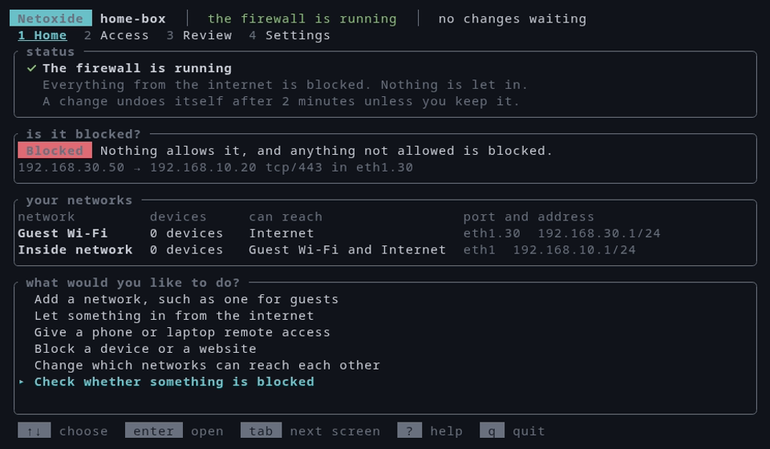

The Home menu has the same tasks as the web UI: add a network, let something in from the internet, give a phone or laptop remote access, block a device or a website, and check whether something is blocked. A task is a short form. `tab` moves between its lines, the left and right arrows change an answer that has a fixed set, `enter` sends it and `esc` leaves without changing anything. Sending a form saves a waiting change and takes you to Review. Nothing is applied until you press enter there.

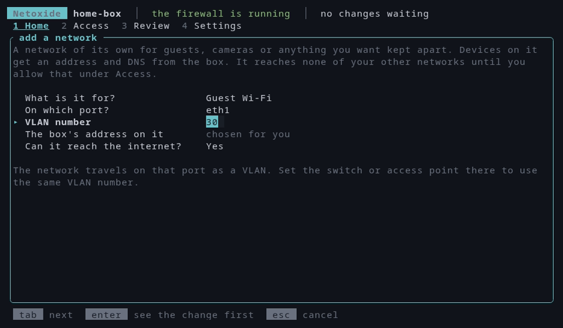

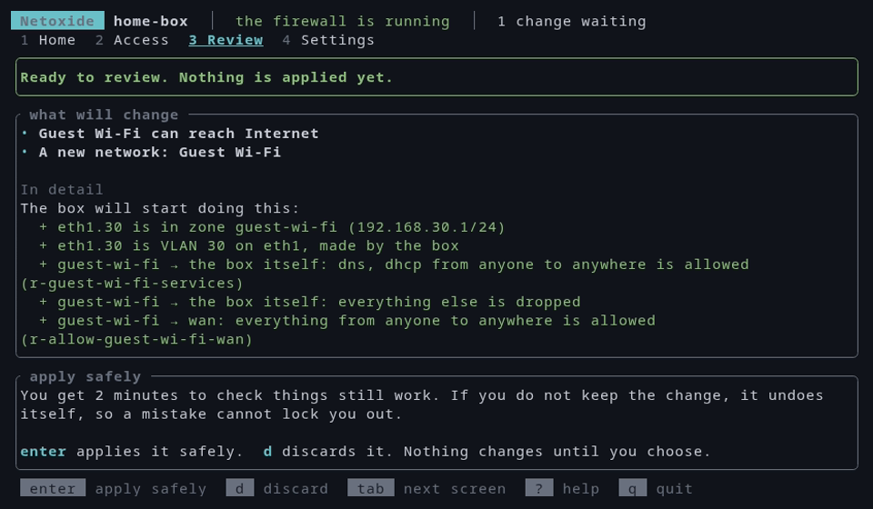

Applying from Review always uses a two-minute timer. While it runs, a bar at the top counts down: `y` keeps the change and `r` undoes it, from any screen.

Adding a VPN device shows its settings once, with a code to scan when the terminal is big enough (about 80×45) and as text otherwise. `esc` closes them for good.

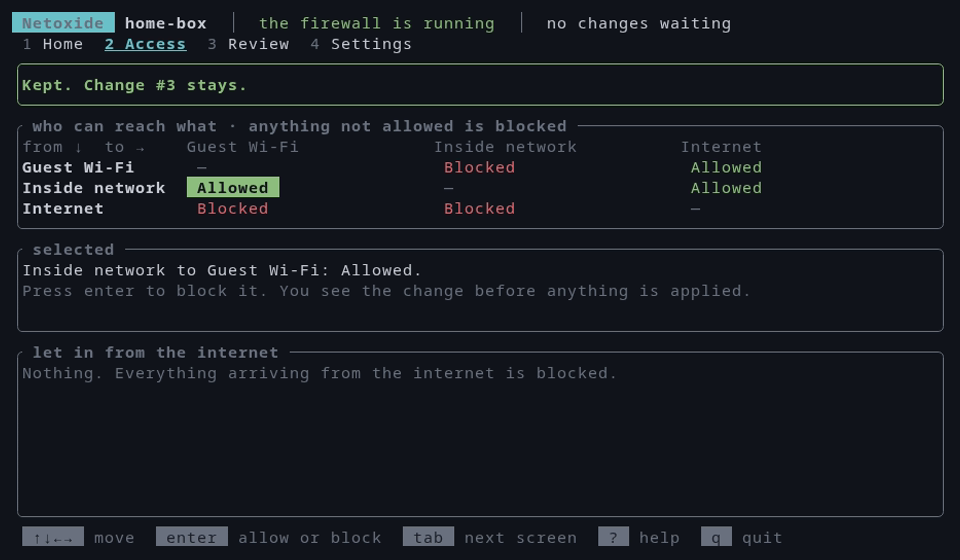

A grid cell is Allowed, Blocked, or it names what its own rules do. The last kind, and anything from the internet, is not changed from the grid.

### The detailed screens

Each is a switch on Settings and adds a tab. `A` switches all of them on or off at once. The choice is kept in `~/.config/netoxide/tui-screens`. A switch changes nothing on the box. These screens need a terminal of at least 132×34.

| Screen | Shows | Keys |
| --- | --- | --- |
| Policy | Zone pairs and their rules from the running config, with the kernel's packet counter per rule | `←→` pair, `↑↓` rule, `x` explain a packet the rule is about |
| NAT | Port forwards and outbound NAT | |
| Interfaces | Interfaces, zones and addresses from the running config | |
| Changes | Candidates, the technical plan for the selected one, the running commit | `c` commit with a reason, `w` confirm window (30 s, 2, 5 or 10 min) |
| Explain | A packet you type, judged by the running config and the selected candidate side by side | `e` edit, `enter` run, `m` compare on or off |
| Audit | The audit log, newest first | `↑↓` |

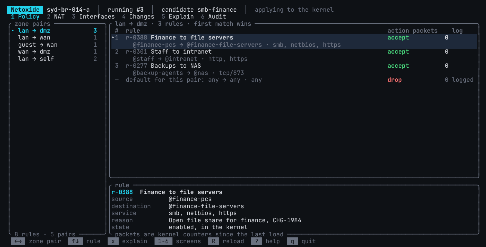

`tab` and the digits move between the tabs that are showing, and `?` lists the keys.

The terminal UI cannot edit a single rule yet, and it has no first-run setup: set a new box up with `ox init` or from a browser. Run it without `--socket`, `--live` or `--remote` to see the eleven designed screens with sample data.

## The web UI

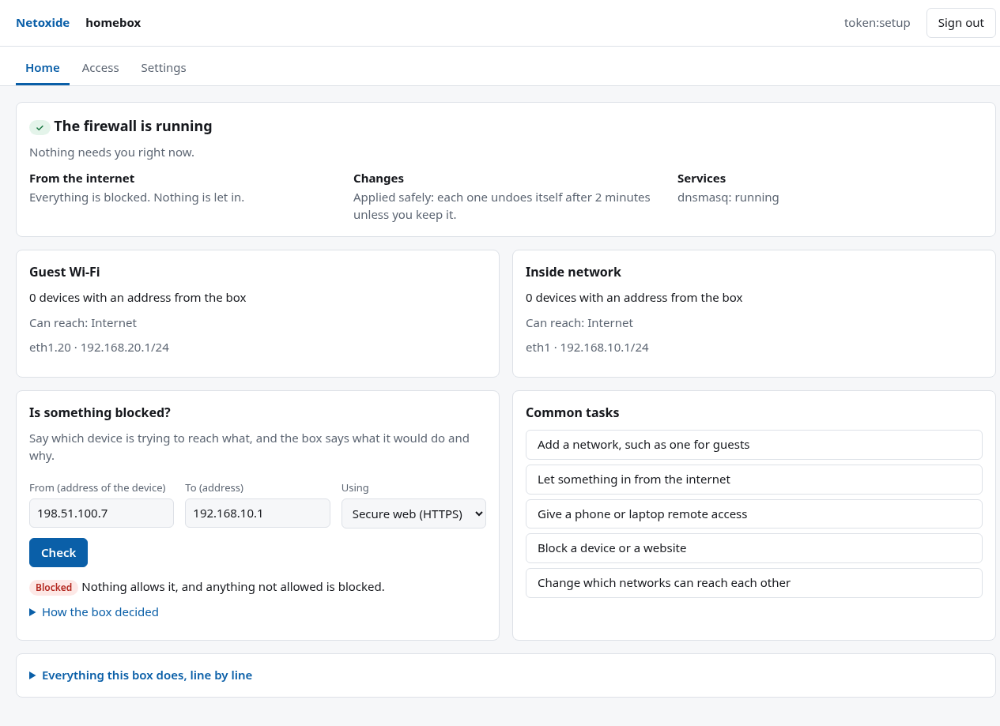

The web UI has two layers. The simple one is what everyone sees. The advanced one is the same box in full detail, a screen at a time, switched on in Settings.

### Getting in

Start the daemon with an HTTPS listener (`OXD_ARGS=--listen [::]:8443` in `/etc/netoxide/oxd.env`) and open `https://<box>:8443/`. The daemon makes its own certificate on first start, so the browser warns until you give it a real one with `--tls-cert` and `--tls-key`.

- **A box with no config** shows Setup. It asks for the setup code, which the box prints when it starts and shows in `ox status` on the box. Setup only answers a device on a private or local address, shuts after ten wrong codes, and shuts for good once a config is running. It hands you an admin access token at the end: save it.
- **A box that is set up** asks for an access token. Make more with `ox token create <name> --role <role>`.

### The simple layer

| Screen | What it is for |
| --- | --- |
| Setup | Three steps: the code, which port is the internet and which are yours, and a review of what the box will do |
| Home | Status in one line, your networks with what each can reach, "Is something blocked?", and the common tasks: add a network, let something in, give a device remote access, block a device |
| Access | Who can reach what, as a grid, and what is let in from the internet |
| Review | One waiting change in a sentence, with Apply safely, Discard and Not now |
| Settings | The basics, and the switches for the advanced screens |

A grid cell is Allowed, Blocked, or it names what its own rules do ("Only web, ping", "3 rules", "1 service let in"). The last kind cannot be changed from the grid.

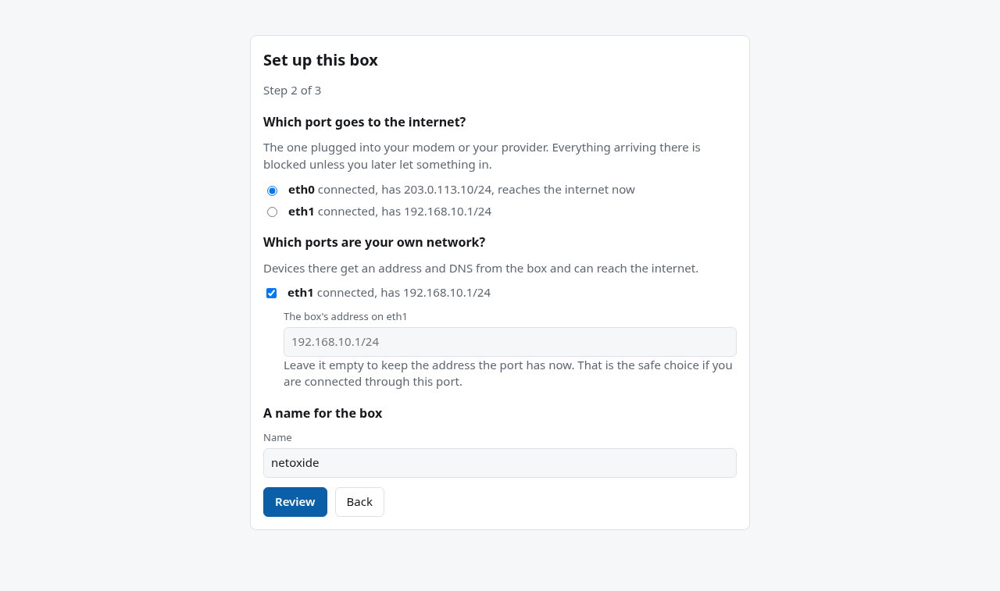

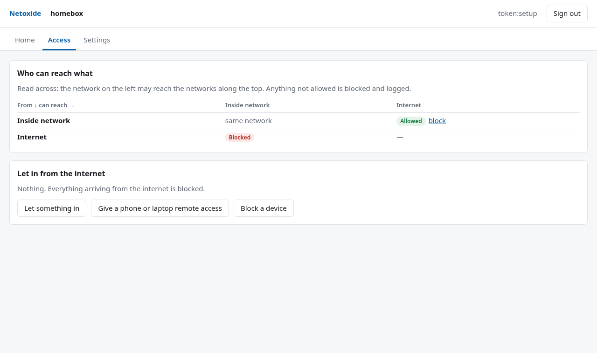

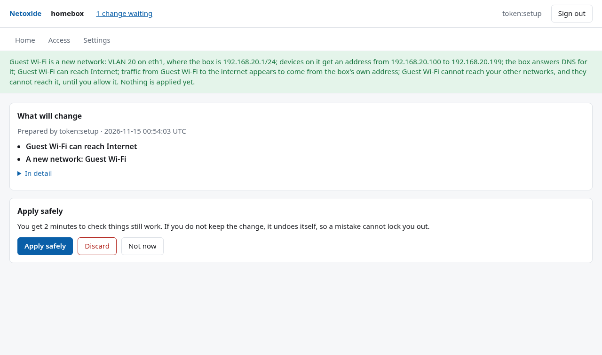

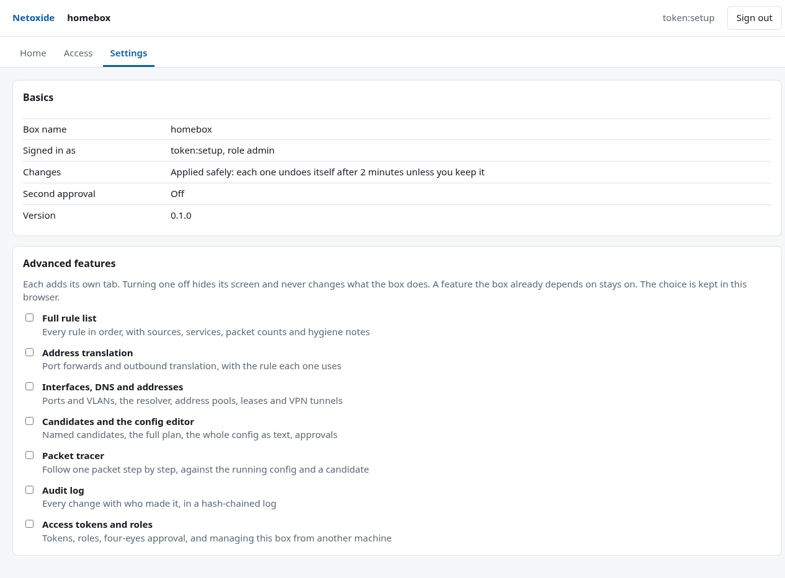

Applying a change always starts a two-minute timer. A bar at the top of every screen counts down with Keep it and Undo now.

### The advanced layer


| Switch | Tab | What it shows |
| --- | --- | --- |
| Full rule list | Rules | Every zone pair with its rules, packet counts and hygiene notes |
| Address translation | NAT | Port forwards and outbound NAT |
| Interfaces, DNS and addresses | Network | Interfaces, DNS, address pools, leases and VPN tunnels |
| Candidates and the config editor | Changes | Named candidates with their full plan, the whole config as text with a check, approval, commit with a choice of timer |
| Packet tracer | Explain | A packet you describe, judged by the running config and a candidate side by side |
| Audit log | Audit | The audit log, newest first |
| Access tokens and roles | Admin | Tokens, roles, four-eyes approval, and the certificate fingerprint for `ox remote add` |

A switch only shows or hides a screen and is remembered in the browser. A screen the box already depends on is on whatever the switch says: the rule list when any pair has rules of its own, and Changes when four-eyes approval is on.

The page is three static files compiled into the daemon, with no build step and nothing loaded from elsewhere.
