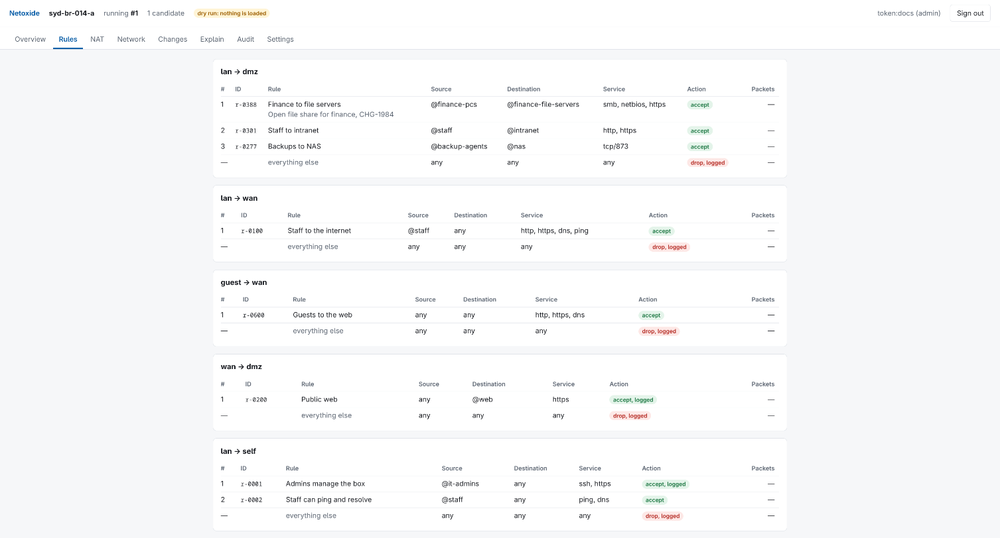

# The terminal UI and the web UI

Both show the same daemon. Use whichever you like; they can be open at once.

- [The terminal UI](#the-terminal-ui)
- [The web UI](#the-web-ui)

## The terminal UI


```sh
cargo run -p netoxide-tui --release -- --socket $OX_SOCKET
```

It needs a terminal of at least 132×34. Everything on screen comes from the daemon and is read again once a second.

| Screen | Shows | Keys |
| --- | --- | --- |
| Policy | Zone pairs and their rules from the running config, with the kernel's packet counter per rule | `←→` pair, `↑↓` rule, `x` explain a packet the rule is about |
| NAT | Port forwards and outbound NAT | |
| Interfaces | Interfaces, zones and addresses from the running config | |
| Changes | Candidates, the plan for the selected one, the running commit | `c` commit, `w` confirm window |
| Explain | A packet you type, judged by the running config and the selected candidate side by side | `e` edit, `enter` run, `m` compare on or off |
| Audit | The audit log, newest first | `↑↓` |

`y` keeps an unconfirmed commit and `r` undoes it, from any screen. A commit from the TUI always has a confirm window (30 s, 2, 5 or 10 min) and asks for a reason first.

The TUI cannot edit rules or save candidates yet. Write the config in a file and use `ox candidate save`. Run it without `--socket` to see the eleven designed screens with sample data.

## The web UI



Start the daemon with an HTTPS listener and make a token:

```sh
oxd --listen 0.0.0.0:8443 ...
ox token create laptop --role operator --days 90
```

Open `https://<box>:8443/` and sign in with the token. The daemon makes its own certificate on first start, so the browser warns until you give it a real one with `--tls-cert` and `--tls-key`.

| View | What it shows |
| --- | --- |
| Overview | The running commit, services, and what the box does in plain sentences |
| Rules | Every zone pair with its rules, packet counts and hygiene notes |
| NAT | Port forwards and outbound NAT |
| Network | Interfaces, DNS, address pools and the addresses handed out |
| Changes | Candidates with their plan; forward a port, block a device, or edit the whole config with a check before saving; approve and commit with an undo timer |
| Explain | A packet you describe, judged by the running config and a candidate side by side |
| Audit | The audit log, newest first |
| Settings | Four-eyes approval, access tokens and roles for admins; the certificate fingerprint for `ox remote add` |

A commit waiting to be kept shows a countdown with Keep and Undo on every view. The page is three static files compiled into the daemon, with no build step and nothing loaded from elsewhere.
