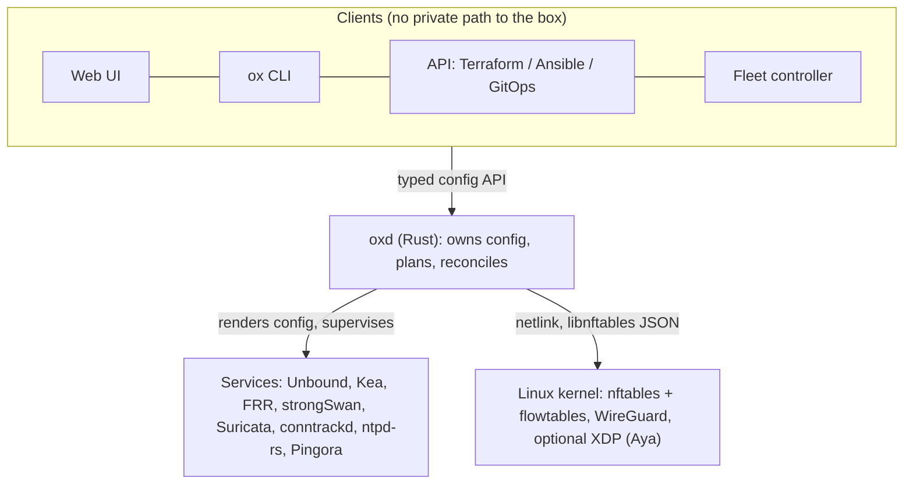
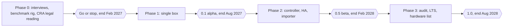

# Enterprise spec: a Rust open-source firewall

Nov 14, 2026 · @Matt

## Summary

Netoxide is a working name for an open-source firewall and router OS on Linux, with a Rust control plane, built for teams that run 10 to 300 firewalls across sites. Its claim is that a buyer can check every promise it makes. The source is public from the first commit, the config has a published schema, upgrades are signed images that roll back on a failed boot, and the HA test results ship with each release.

The research found one gap that no open project fills today. Nobody combines free stable releases, typed config with commit-confirm, a fleet controller in the open core, image upgrades and tested HA. pfSense and OPNsense charge for fleet management and keep a schemaless XML config. VyOS has the config model and sells its stable builds. NethSecurity has the controller and an OpenWrt config model. nfSensei, the Rust firewall from pfSense's co-founder, has no public source and one developer.

Rust earns its place twice. Against pfSense and OPNsense, it gives a control plane that never runs a shell command, which removes the command-injection bugs that fill their advisory lists. Against Fortinet, Ivanti and other commercial vendors, it gives a memory-safe management and VPN layer, where their mass-exploited bugs include memory corruption in C daemons. No open firewall with public source offers that today, and it is part of the gap. Packets stay in the Linux kernel, so the spec makes no throughput claim from Rust.

Three limits shape the scope. Netgate announced on 29 October 2026 that pfSense 26.10 makes all features free, so "pfSense is closing" is no longer a pitch. The evidence does not support competing with Fortinet or Palo Alto on application identification and threat feeds. And the segment size, willingness to pay and every performance comparison rest on thin data, which the roadmap's first phase pays to fix.

The full research report is at [`docs/research/market-gap.md`](research/market-gap.md).

## Market research

Each open rival holds part of the product and none holds all of it. The table shows the state on 14 November 2026.

| Product | Stable release free and open | Transactional config | Fleet management | Main limit |
| --- | --- | --- | --- | --- |
| [pfSense 26.10](https://www.netgate.com/blog/pfsense-at-20), announced | Features free, licence unstated | No, schemaless XML | [Paid per device, no air-gap](https://www.netgate.com/support/frequently-asked-questions-nexus) | Free users reinstall to upgrade |
| [OPNsense](https://docs.opnsense.org/development/architecture.html) | Yes | No, XML with partial API | Paid Business Edition, 149 EUR a year | Regressions in 2026 releases |
| [VyOS](https://forum.vyos.io/t/lts-release-package-repositories-permanently-closed-for-public-access/14637) | No, LTS is subscriber-only | Yes, but rollback reboots | Not confirmed | Router first, weak firewall UI |
| [NethSecurity](https://nethsecurity.org/) | Yes, with paid enterprise repo | Inherits OpenWrt UCI | Yes, first-party controller | API not documented in our notes |
| [nfSensei](https://nfsensei.org/) | No public source | Claimed, behind beta login | Labs feature | One developer, HA lab-tested only |

pfSense and OPNsense share one design from m0n0wall. PHP pages write a single config.xml and regenerate service configs. A Netgate engineer wrote that new API endpoints "can be confusing (because config.xml is schemaless)" ([Netgate forum](https://forum.netgate.com/post/1225337)). Terraform providers for both are community projects below 1.0. The vendor docs state the hard limits themselves. pfSense HA supports two nodes and pfsync has no authentication ([Netgate HA docs](https://docs.netgate.com/pfsense/en/latest/highavailability/index.html)). OPNsense documents single-threaded packet processing by default and single-threaded IPS re-injection ([OPNsense performance docs](https://docs.opnsense.org/troubleshooting/performance.html)).

Netgate changed its model three times in six years. Plus went closed in January 2021, the free Home+Lab licence ended in October 2023, and the 29 October 2026 announcement merges the editions again. Free users will move between versions by reinstalling, which reformats the disk ([IT-Connect](https://www.it-connect.tech/pfsense-26-10-unifies-ce-and-plus-making-all-features-free/)). 26.10 had not shipped when we checked.

nfSensei has taken the "pfSense in Rust" position. Its feature list is long. It covers three data planes, FRR, Suricata, VRRP with conntrackd, and a pfSense importer. Its GitHub organisation has no public repositories, and its own release notes say HA state sync was not replicating state until 1 October 2026 ([nfSensei blog](https://blog.nfsensei.org/thirty-days-of-shipping.html)). It shipped 45 releases in 30 days.

Commercial vendors give an open firewall its best arguments in their own documents. Meraki devices under co-term licensing stop passing client traffic 30 days after a lapse ([Meraki docs](https://documentation.meraki.com/General_Administration/Licensing/License_Problem_-_Out_of_Compliance)). A FortiGate with an expired contract cannot take a major or minor upgrade ([Fortinet docs](https://docs.fortinet.com/document/fortigate/7.4.0/new-features/299518)). VulnCheck counted 181 exploited edge-device vulnerabilities in 2025 ([VulnCheck](https://wwv.vulncheck.com/hubfs/Research/Exploring-Network-Edge-Devices-VulnCheck-State-of-Exploitation-2026.pdf)). Firewall revenue grew 18% in Q2 2026 on hardware refresh ([Dell'Oro](https://www.delloro.com/newsroom/firewall-growth-doubles-to-18-percent-in-2q-2026-on-refresh-and-capacity-expansion/)).

The user voice is the weakest part of the research. Reddit blocked every fetch, so the evidence comes from Hacker News, the Lawrence Systems forum and vendor forums.

## The gap

The gap is open fleet operations that a buyer can verify, for shops that already run pfSense or OPNsense. Each of the five parts answers a documented fault in a rival.

| What Netoxide ships | Fault it answers | Evidence strength |
| --- | --- | --- |
| Stable releases, source and every feature free under one licence | VyOS sells LTS builds, nfSensei has no public code, pfSense 26.10 licence unstated | Strong |
| Typed config with a published schema, commit-confirm and rollback without reboot | Schemaless config.xml, VyOS rollback reboots the box | Strong |
| Fleet controller with RBAC and air-gap support in the open core | Nexus is paid per device and excludes air-gapped systems, OPNcentral is Business Edition only | Strong |
| Signed A/B image upgrades with automatic rollback | Free pfSense users reinstall to upgrade, OPNsense 26.x regressions | Strong as announced for pfSense |
| HA with authenticated state sync and published failover test results | Two-node unauthenticated pfsync, nfSensei HA lab-tested only | Strong |

A sixth part sits under the five. Netoxide is the only open firewall whose first-party network-facing code is memory-safe and readable. pfSense and OPNsense are PHP over C services, the commercial vendors ship closed C daemons, and nfSensei's Rust code is not public. The research found no buyer asking for this by name, so it supports the pitch and does not lead it.

The evidence does not support several tempting claims, and the spec leaves them out.

- No thread asks for a Rust firewall. nfSensei's best Hacker News post reached 19 points.
- Memory safety would not have prevented the pfSense and OPNsense bug record, which is command injection and XSS. The no-shell design does that work.
- No same-hardware benchmark compares nftables, XDP, pf and VPP. We make no speed claim until we run one.
- We found no tender for an open-source firewall in EU public procurement.
- We found no demand for an AI assistant. The one reaction on record hopes nfSensei's is optional.

## Positioning and target users

Netoxide is the firewall for people who run many firewalls. The positioning line is "every claim checkable", and each release publishes the artefacts that back it.

| Ring | Who | What they run today | Why they move |
| --- | --- | --- | --- |
| 1 | MSPs and multi-site IT teams with 10 to 300 boxes | pfSense or OPNsense, often with home-grown scripts | Per-device fleet fees, no real config-as-code, upgrade risk across the fleet |
| 2 | EU organisations answering CRA and supply-chain questionnaires | OPNsense, Sophos, FortiGate | SBOM, declared support period, EU steward, self-hosted management |
| 3 | Platform teams running branch and edge sites | VyOS, plain nftables, NixOS routers | GitOps workflow with a supported product behind it |

Home labs are a first-class audience and get the same software free. A single box has to be easy to set up and run without reading this spec. Home-lab users are the test bed and the contributor pool, and they are the people who later bring the product to work, which is how pfSense and OPNsense grew. They are not the paying segment.

Evidence for ring 1 is moderate. Both incumbents put their paid work into fleet management, a Netgate forum user evaluating Nexus for about 100 firewalls asked for finer RBAC ([Netgate forum](https://forum.netgate.com/post/1245184)), and a third-party SaaS sells OPNsense central management ([NetDefense](https://netdefense.io/opnsense-central-management)). We have no sizing. Phase 0 of the roadmap includes 15 interviews with fleet operators before the build starts.

Netoxide does not replace a FortiGate or Palo Alto where the buyer needs application identification, TLS inspection at scale and a paid threat-intelligence feed. It also does not chase the 129 USD UniFi gateway buyer.

### The memory-safety claim

For ring 2 and for anyone replacing a commercial firewall, memory safety is an explicit claim. NSA and CISA urged memory-safe languages in June 2025 guidance ([CISA](https://www.cisa.gov/news-events/alerts/2025/06/24/new-guidance-released-reducing-memory-related-vulnerabilities)), and VulnCheck counted 181 exploited edge-device vulnerabilities in 2025.

The claim has to be one a buyer can check, so each release publishes three numbers.

- The share of network-facing code written in Rust, by listening socket. The management API, the VPN portal, the reverse proxy, NTP and the fleet channel are Rust at 1.0.
- The count of `unsafe` blocks in first-party crates, with the audit note for each.
- The embedded C services still in the image, each with its sandbox profile. Unbound, Kea, FRR, strongSwan and Suricata are on that list at 1.0.

Two limits keep the claim honest. No published figure says what share of firewall exploits are memory corruption. The closest is Horizon3's estimate of about 20% of 2023 KEV additions across all products ([Horizon3](https://www.horizon3.ai/?p=242945)). And Rust does not stop logic bugs, as Pingora's three request-smuggling CVEs in 2026 showed.

Performance is not part of the pitch. Throughput comes from the kernel packet path, and we claim nothing until the Phase 0 benchmark publishes results.

## Product principles and non-goals

Seven rules decide design arguments. When two conflict, the earlier one wins.

1. **The box never stops forwarding.** No licence state, expired subscription or unreachable controller changes packet handling or blocks a security fix.
2. **Config is data.** One typed document describes the whole box. The UI, CLI, API and controller all edit that document and nothing else.
3. **Every change is a transaction.** A commit applies in full or not at all, and an unconfirmed commit reverts by itself without a reboot.
4. **No shell.** The control plane never builds a command string. It talks to the kernel over netlink and to services over typed APIs or generated config files.
5. **Verified before broad.** A feature ships when it has a test that runs on every release. Fewer features with proof beat nfSensei's feature count.
6. **Self-hosted first.** The controller runs on the customer's hardware, air-gapped if they want. A hosted option is a convenience and never a requirement.
7. **One licence, bound by governance.** No closed edition and no relicensing path.

One more rule sits beside these seven. **Easy first, advanced within reach.** A home-lab user gets a working, safe box from a short guided setup with no config file to write. An operator of 200 boxes gets the full model. Both use the same config and the same tools, so the easy path writes ordinary config that the advanced path can read and change. Nothing a single box needs may depend on the controller, a login server or a fleet feature.

Non-goals for 1.0.

- Application identification and a proprietary threat feed
- TLS interception
- A package or plugin system that runs third-party code as root
- Active/active HA
- A built-in AI assistant
- A pure-Rust services stack. Unbound, Kea, FRR and Suricata are embedded where the Rust option is not production-ready
- Wi-Fi access point features

## Architecture

One Rust daemon, `oxd`, owns the config and reconciles the box to it. Packets stay in the Linux kernel on nftables. Every other component is either a client of `oxd` or a service that `oxd` supervises.

_(Diagram rebuilt from the text above; the original canvas diagram does not export.)_

The four clients hold no private path to the box. `oxd` writes service configs and kernel state, and nothing else on the system changes either.

### Config engine

- The config is one document with a versioned schema, published as JSON Schema and as Rust types generated from the same source. Humans write it in TOML or YAML, and the API speaks JSON.
- `oxd` keeps a running config and any number of named candidates. A commit validates the candidate, computes a plan, and applies it in dependency order.
- `commit --confirm 5m` applies the candidate and reverts unless the operator confirms. Revert replays the previous running config through the same reconciler. It does not reboot.
- The firewall ruleset swaps atomically with one nftables transaction, so no packet sees a half-applied ruleset.
- `oxd` stores the last 100 commits on the box with author, time, diff and the reason text.

### Data plane

- nftables through libnftables JSON, with flowtables for established connections. Software flow offload is on by default, and hardware offload is opt-in per NIC model after it passes our test matrix.
- The rule compiler emits sets, maps and verdict maps. It never emits a linear chain longer than 32 rules, because linear rulesets collapsed to 250 kpps at 1,000 rules in the one benchmark we found ([uv.es](https://www.uv.es/cuan/vyos_bsdrp/)).
- An optional XDP program, written with Aya, drops traffic from blocklists and absorbs floods before conntrack. Aya is still 0.x, so the box works fully without it.
- No VPP or DPDK in 1.0. A second data plane doubles the test matrix.

### Services

`oxd` renders each service's config from the typed document and supervises the process in its own systemd unit with a seccomp profile and no shell.

| Function | 1.0 choice | Rust option to adopt later | Why not yet |
| --- | --- | --- | --- |
| TLS and crypto | rustls with aws-lc-rs | In use at 1.0 | FIPS 140-3 certificates are active |
| Management HTTP | axum on rustls | In use at 1.0 |  |
| NTP | ntpd-rs | In use at 1.0 |  |
| WireGuard | Kernel WireGuard | None planned | BoringTun has been forked by three teams |
| IPsec | strongSwan over VICI | None | No Rust IKEv2 daemon found |
| DNS resolver | Unbound | Hickory | Its crate page advises against production use |
| DHCP | Kea | dora | Self-described early release |
| Routing | FRR | Holo | 0.9 with a small team |
| IDS/IPS | Suricata 8 | None | Suricata is the only option |
| Reverse proxy | Pingora | In use at 1.0 |  |

### OS base

- A minimal image built from Debian stable packages with mkosi. The root filesystem is read-only and verified with dm-verity.
- Two system slots, A and B. An upgrade writes the inactive slot, boots it once, runs health checks, and marks it good. A failed boot or failed check returns to the previous slot.
- Unified kernel images, signed for Secure Boot. TPM 2.0 measured boot seals the secrets partition where the hardware has one.
- State lives on a separate encrypted partition that holds the config history, keys and logs.
- No package manager on the box and no interactive root shell by default. A break-glass console exists, and every use lands in the audit log.

The OS base choice is the least researched part of this section. Our notes have design arguments for it and no 2026 status check on mkosi, systemd-sysupdate or RAUC.

## Functional requirements

1.0 covers what a pfSense fleet uses on most boxes and stops there. "Must" items gate the 1.0 release, and "Later" items have a design slot and no date.

| Area | Must for 1.0 | Later |
| --- | --- | --- |
| Filtering | Stateful IPv4 and IPv6 rules, zones, address and port groups, schedules, per-rule counters and logging | Layer 7 hints from Suricata |
| NAT | Source, destination, 1:1, hairpin, NAT64, outbound NAT per zone | CGNAT port blocks |
| Interfaces | VLAN, bridge, LAG with LACP, PPPoE, DHCPv6-PD with prefix tracking | VXLAN |
| Multi-WAN | Gateway groups, health probes, failover, policy routing | Per-flow load balancing by measured loss |
| Routing | Static, BGP and OSPF through FRR, with typed config | Holo once it reaches 1.0 |
| VPN | WireGuard site-to-site and remote access, IPsec IKEv2 | OpenVPN import only, for migration |
| DNS and DHCP | Unbound with DNSSEC and DoT forwarding, per-zone blocklists, Kea DHCPv4 and v6 with static leases, router advertisements | Split-horizon views |
| IDS/IPS | Suricata 8 inline with ET Open rules, per-zone enable, alert export | Managed rule tuning across a fleet |
| Identity | Rules that match a user or group from OIDC login on the WireGuard remote-access portal | Device posture checks |
| Traffic shaping | CAKE per interface with per-zone tiers | Per-user quotas |
| Certificates | Built-in ACME client, internal CA for VPN and management | SCEP |

IPv6 gets the same test coverage as IPv4. Every rule, NAT and VPN test runs in both families, because IPv6 and prefix delegation were recurring complaints in the forums we could read.

One model for interfaces. A zone holds interfaces, rules attach to zone pairs, and the UI never asks the user to choose between "floating" and "interface" rules.

## Management

One API does everything, and the web UI, the CLI and the fleet controller are clients of it with no private endpoints.

### On the box

- **API.** HTTP and JSON with an OpenAPI document generated from the Rust types. The API covers 100% of the config schema by construction, because the schema is the API.
- **CLI.** `ox` runs on the box or remotely. `ox diff`, `ox commit --confirm`, `ox rollback 3` and `ox explain` are the core commands.
- **Web UI.** A single-page app served by `oxd`. Every form shows the config diff it will commit, and every page links to the same object in the API.
- **Tokens.** API tokens carry scopes per config section and an expiry. No token inherits full admin rights by default.

### First run on one box

A single box must work as a home or small-office router within ten minutes of first boot.

- **Guided setup.** `ox init`, and the same flow in the web UI, detects the interfaces, asks which one faces the internet, and writes a complete config. That config lets the inside network out, hides it behind the box's address, serves DHCP and DNS to it, allows management from inside only, and drops everything inbound.
- **Plain-language actions.** "Forward a port", "block a device" and "add a guest network" are single actions that produce ordinary rules, shown before they are applied.
- **Safe by default.** Before any config exists the box drops inbound traffic. Every change made remotely uses commit-confirm unless the user turns it off.
- **No extra parts.** No controller, login server or licence step is needed on one box.
- **The same model underneath.** The setup's output is the normal config file. A user who outgrows the guided actions edits that file, and nothing has to be migrated.

DHCP and DNS move up in priority because of this. A box that cannot hand out addresses cannot replace a home router.

### As code

- A first-party Terraform and OpenTofu provider and an Ansible collection, generated from the schema and released with every version. pfSense and OPNsense have only community providers below 1.0.
- A GitOps mode. The box or the controller pulls a signed config from a Git repository, runs `plan`, and applies under commit-confirm. A box that loses the WAN after a pull reverts by itself.
- `ox plan` runs offline against a config file, so CI can validate a pull request without touching a device.

### Fleet controller

The controller is open source, self-hosted and part of the same release.

- Inventory, health and version for every box, over an outbound mTLS connection from the box. No inbound port on the firewall.
- Config templates with per-site variables, so 200 branches share one policy and differ in addresses.
- Staged rollouts for config and upgrades. A rollout moves through rings, waits for health checks, and halts when a ring fails.
- Multi-tenancy for MSPs. A tenant's boxes, configs, logs and users are isolated, and the controller's own RBAC decides who crosses tenants.
- Air-gapped operation. The controller imports signed release bundles from a file and needs no outside connection.
- A box keeps working when the controller is down. The controller holds no secret that the box needs to forward traffic.

The controller stores secrets encrypted with a key the customer holds. SonicWall's 2025 breach exposed config backups for every cloud-backup customer, and this design keeps that failure on the customer's own hardware and under their own key.

## Enterprise requirements

All of these ship in the open core. None is held back for a paid edition.

### High availability

- Active/backup pairs with VRRP. Active/active is out of scope, on the advice of the netfilter maintainers for asymmetric routing ([netfilter list](https://spinics.net/lists/netfilter/msg58576.html)).
- State sync runs over an authenticated, encrypted channel. pfsync has no authentication.
- 1.0 uses conntrackd for state sync, wrapped and supervised by `oxd`. conntrackd is asynchronous and has documented races, so the release publishes measured results. The target is under 1 second of forwarding loss and at least 99% of established TCP flows surviving a failover at 100,000 concurrent connections.
- Config sync is a commit to both nodes in one transaction. A commit that fails on the backup rolls back on the primary.
- A Rust state-sync daemon with a pfsync-style defer mode is a post-1.0 project and a candidate for grant funding.

### Access control and audit

- SSO with OIDC and SAML. Local accounts need TOTP or a passkey.
- Roles are sets of scopes over config sections and actions. Built-in roles are viewer, operator, network admin, security admin and auditor.
- Four-eyes commits. A policy can require a second user to approve a candidate before it applies.
- The audit log records every login, commit, API call that changes state, and break-glass session. Entries are hash-chained, exportable, and write-once on the box. The Five Eyes edge-device guidance of February 2025 asks for tamper-resistant logging by default ([SecurityWeek](https://www.securityweek.com/five-eyes-agencies-release-guidance-on-securing-edge-devices/)).

### Supply chain and updates

- Reproducible builds, with a CycloneDX SBOM and SLSA provenance attached to every release. Signatures use Sigstore and an offline root key.
- `cargo-deny` and `cargo-vet` gate every dependency change. `unsafe` is forbidden in first-party crates outside a small audited FFI layer.
- A public security policy with a 90-day disclosure limit, VEX statements for embedded components, and advisories in CSAF.
- Two channels. Stable gets a release every 6 months, and LTS gets one every 24 months with 5 years of security fixes. Both are free. OPNsense users asked for exactly this kind of slow channel.
- An independent security audit of `oxd` and the controller before 1.0, published in full.

### Compliance path

- The EU Cyber Resilience Act lists firewalls as Important products, Class II, which requires a notified body. It applies in full on 11 December 2027 ([OpenSSF](https://policy.openssf.org/CRA/stewards-one-pager.html)). The steward entity carries light duties, and whoever sells appliances or paid builds is a manufacturer with the full set.
- FIPS mode uses aws-lc-rs in its validated configuration for TLS and management. Kernel WireGuard is not FIPS-approved, so FIPS mode offers IPsec only.
- Common Criteria NDcPP is a post-1.0 decision that depends on a paying customer who needs it.

Nobody on the research side read the CRA text itself. Get a legal reading of steward status and Class II cost before the company structure is fixed.

## Observability and diagnosis

The firewall answers "why did this packet do that" with the rule, the commit and the author. This is the part of the product that no rival in the research offers, and it follows directly from typed config.

- **`ox explain`.** Given a 5-tuple and an ingress interface, it returns the verdict, the matching rule, the NAT applied, the route chosen, and the commit that introduced the rule. It evaluates the compiled ruleset, so it answers for hypothetical packets and for candidate configs before commit.
- **Live trace.** `ox trace` uses nftables tracing to follow a real packet through the chains and prints the same output as `explain`.
- **Change impact.** `ox plan` lists which existing flows a candidate would have blocked in the last 24 hours, from flow logs. An operator sees "this commit breaks 3 active services" before applying.
- **Rule hygiene.** A report of shadowed rules, rules with zero hits in 90 days, and rules wider than their observed traffic.
- **Flow logs.** Per-connection records with zone, rule ID, user identity where known, bytes and duration. Export as IPFIX and as JSON lines.
- **Metrics.** A Prometheus endpoint and OpenTelemetry export for interface, conntrack, per-rule, VPN, HA and service health metrics.
- **Logs.** Structured JSON to syslog over TLS, with rule IDs that stay stable across commits so SIEM queries do not break.
- **Health verdicts.** The box names its own limits, such as conntrack table at 85%, a CPU core saturated by softirq, or a WAN with 4% loss. Each verdict cites the measurement behind it.

We did not find user complaints about rule debugging in the sources we could reach. Reddit was unreadable, so this is our bet, to be tested in the Phase 0 interviews.

## Performance targets and hardware

These are design targets that we set, not measured results. The research found no same-hardware benchmark of nftables against pf or VPP, so Phase 0 builds a public test rig and the numbers below get confirmed or revised there.

| Tier | Reference hardware | Firewall and NAT target | With Suricata inline | Concurrent connections |
| --- | --- | --- | --- | --- |
| Branch | 4-core Intel N100, 8 GB, 4 x 2.5GbE | 2.5 Gbit/s at 1500-byte packets | 500 Mbit/s | 500,000 |
| Site | 8-core x86, 16 GB, 2 x 10GbE | 10 Gbit/s at 1500-byte packets | 2 Gbit/s | 2,000,000 |
| Core | 16-core x86, 32 GB, 2 x 25GbE | 25 Gbit/s with flow offload | 5 Gbit/s | 8,000,000 |

Targets that do not depend on hardware tier.

- A commit of a 5,000-rule config applies in under 2 seconds, with no dropped established flow.
- Throughput at 5,000 rules stays within 10% of throughput at 50 rules, which the set-and-map compiler exists to deliver.
- `oxd` idles under 150 MB of memory. The API answers a config read in under 50 ms.
- An upgrade takes one reboot and under 90 seconds of forwarding loss on a single box, and zero loss on an HA pair beyond the failover target.
- Cold boot to forwarding in under 30 seconds on the branch tier.

Hardware scope for 1.0 is x86\_64 with UEFI, and virtual images for KVM, Proxmox, VMware and the three large clouds. A tested hardware list names exact models and NICs, starting with Intel igc, igb, ixgbe, i40e and ice, and Mellanox mlx5. Linux supports Realtek 2.5GbE and the Intel E610 in tree, where FreeBSD needs out-of-tree drivers ([Netgate forum](https://forum.netgate.com/topic/198287/e610-xt2)).

Arm is a 1.1 target. MediaTek flow offload on boards such as the Banana Pi R4 is a Linux-only path, and the forum reports corruption bugs that we would need to reproduce first.

## Migration from pfSense and OPNsense

The importer is a launch requirement. Users in the threads we read call pfSense and OPNsense features "essentially the same", so what keeps them in place is the cost of moving a config.

- `ox import config.xml` reads a pfSense or OPNsense backup and writes a Netoxide candidate config plus a report.
- The report has three lists. Translated items map one to one. Changed items work but differ, such as floating rules becoming zone-pair rules. Unsupported items name the feature and the manual step.
- The importer never guesses. An item it cannot translate exactly goes to the changed or unsupported list.
- Coverage target for 1.0 is 95% of items translated across a corpus of at least 200 real configs donated by beta users, with secrets stripped by a tool we ship.
- `ox import --verify` replays a pcap or a list of test flows against both the old ruleset's intent and the new compiled ruleset, and prints every flow whose verdict differs.
- A side-by-side mode. Netoxide runs as the HA backup's replacement on spare hardware, mirrors the rules, and logs what it would have done for a week before cutover.
- Fleet import. The controller takes a directory of backups and produces one template plus per-site variables where the configs share structure.

OpenVPN gets import-only support. The importer converts OpenVPN site-to-site tunnels to WireGuard or IPsec proposals and flags remote-access setups for manual work.

No rollback tool to pfSense. The old box stays untouched until the operator retires it.

## Licensing, governance and business model

Pick the licence once and make it impossible to change. Every relicensing in the research produced a fork. Terraform led to OpenTofu, Redis to Valkey and Elastic to OpenSearch, and pfSense users still cite 2023.

### Licence and governance

- `oxd`, the CLI, the UI and the controller are AGPL-3.0-or-later. Client libraries, the Terraform provider and the config schema are Apache-2.0 so anyone can integrate.
- Contributors sign off with the DCO. There is no contributor licence agreement, so no single party can relicense.
- A non-profit steward holds the trademark, the signing keys and the release process. An EU seat suits the CRA steward role and ring 2 buyers.
- A written charter states the forwarding promise from principle 1 and the rule that security fixes reach every user on the same day.
- The trademark policy lets anyone ship unmodified builds under the name and requires a rename for modified ones.

AGPL is my recommendation and it has a cost. Some companies ban AGPL software outright, and an appliance OEM may prefer a permissive licence. The alternative is Apache-2.0 throughout, which invites a closed fork by a hardware vendor. This is the first decision for you to make.

### What is free and what is paid

Every feature is free. The paid items are things that cost us money to provide.

| Paid item | Precedent | Reference price in the market |
| --- | --- | --- |
| Support with SLA, per box or per fleet | Netgate TAC | 129 to 799 USD per instance a year |
| Hosted controller for teams that do not want to run one | Sidero Omni over Talos | Not public |
| Certified appliances with the tested hardware list | Netgate and Deciso | 549 to 4,299 USD per unit |
| Migration and design services for fleets | Standard | Per engagement |
| Compliance builds, such as a CRA-assessed or FIPS-configured image with paperwork | OPNsense Business Edition | 149 EUR a year |

The compliance build contains the same code. The buyer pays for the assessment, the paperwork and the liability, which the CRA places on whoever sells it.

No public revenue figure exists for Netgate, Deciso, VyOS or Proxmox, so we cannot size this business from precedent. Grants fund components and not products. A Rust nftables library or a state-sync daemon fits the Sovereign Tech Agency pattern, and the firewall as a whole does not.

## Roadmap

1.0 ships in August 2028 if each of four gates passes, and Phase 0 can stop the project for the cost of three months.

_(Diagram rebuilt from the exit criteria below; the original does not export.)_

The dates assume six full-time engineers from March 2027. Proxmox needed more than two years to bring a narrower Rust firewall to tech preview, so a smaller team means later dates and not a smaller 1.0.

Exit criteria per gate.

1. **Go or stop, end of February 2027.** At least 10 of 15 fleet operators name fleet fees, config-as-code or upgrade risk unprompted, and 5 agree to be design partners. The benchmark rig publishes nftables against pfSense 26.10 on the same hardware. A legal reading of CRA steward status is in hand. We have read what 26.10 shipped and under which licence.
2. **0.1 alpha, end of August 2027.** One box runs filtering, NAT, WireGuard, DNS and DHCP from a typed config. Commit-confirm reverts without reboot in a test that runs on every commit. A/B upgrade rollback passes 500 consecutive power-cut tests. The team's own sites run it.
3. **0.5 beta, end of February 2028.** The controller manages 100 simulated and 20 real fleets. HA meets the failover target in published results. The importer translates 95% of items across 200 donated configs. The Terraform provider ships with the release.
4. **1.0, end of August 2028.** The independent audit is published with all high findings fixed. The LTS branch opens with a 5-year support statement. A tested hardware list covers at least 10 models. The first compliance build has its CRA technical file started with a notified body.

The CRA applies in full from 11 December 2027, before 1.0. Free downloads from the steward are not affected in the same way, and no paid build goes on sale in the EU until its assessment is done.

## Risks and open questions

The largest risk is that the target segment is smaller or less willing to move than vendor marketing implies. Phase 0 exists to find that out cheaply.

| Risk | Why it is real | Response |
| --- | --- | --- |
| Segment evidence is thin | No MSP speaks in their own words in the research, and Reddit was unreadable | 15 interviews gate the build |
| pfSense 26.10 closes the gap | It promises a built-in API, a new GUI and free features | Read what ships. Reinstall-to-upgrade, paid fleet tools and schemaless config remain by Netgate's own account |
| nfSensei opens its source and matures | It has the pfSense founder's name and a long feature list | Compete on verification, governance and fleet operations, where one developer is weakest |
| NethSecurity adds a typed config | It already has a controller, HA and a paid repo | Its UCI base makes that a rewrite. Watch its releases |
| Parity takes longer than planned | Proxmox is past two years at tech preview | Narrow 1.0 scope, importer corpus as the parity measure |
| conntrackd state sync misses the HA target | Documented races and async replication | Publish honest numbers, restrict to active/backup, fund the Rust replacement |
| CRA Class II cost sinks the commercial entity | No sourced cost or duration for the assessment | Legal reading in Phase 0, steward and seller as separate entities |
| AGPL blocks enterprise adoption | Some companies ban it | Decide in Phase 0 with design partners' legal teams |
| Embedded C services carry the bugs Rust was meant to avoid | Unbound, Kea, FRR, strongSwan and Suricata are C or mixed | Sandbox each service, track Hickory, dora and Holo for replacement |

Open questions for you.

- [ ] AGPL-3.0 with Apache-2.0 clients, or Apache-2.0 throughout?
- [ ] Is this a funded company with six engineers, or a solo project? The roadmap assumes the first. A solo version would be the config engine and `ox explain` on a single box, with no controller.
- [ ] Does Netoxide reuse the netwatch diagnosis work for health verdicts, or stay separate?
- [ ] Where does the steward sit, and who are its first board members?
- [ ] Is the name usable? It sits close to Oxide Computer Company, which sells Rust-based servers and networking. I have not checked "Netoxide" for trademark conflicts.

## Sources

The research report with all citations and a claim-by-claim confidence table is at [`docs/research/market-gap.md`](research/market-gap.md). Many pages were read through search summaries, and the report marks which.

- [Netgate, "pfSense at 20"](https://www.netgate.com/blog/pfsense-at-20), the 26.10 merger announcement
- [IT-Connect on pfSense 26.10](https://www.it-connect.tech/pfsense-26-10-unifies-ce-and-plus-making-all-features-free/), reinstall-to-upgrade for free users
- [Netgate HA docs](https://docs.netgate.com/pfsense/en/latest/highavailability/index.html) and [Nexus FAQ](https://www.netgate.com/support/frequently-asked-questions-nexus)
- [Netgate forum post on schemaless config.xml](https://forum.netgate.com/post/1225337)
- [OPNsense architecture](https://docs.opnsense.org/development/architecture.html) and [performance docs](https://docs.opnsense.org/troubleshooting/performance.html)
- [VyOS LTS repositories closed](https://forum.vyos.io/t/lts-release-package-repositories-permanently-closed-for-public-access/14637)
- [NethSecurity](https://nethsecurity.org/)
- [nfSensei](https://nfsensei.org/) and its [thirty days of shipping post](https://blog.nfsensei.org/thirty-days-of-shipping.html)
- [Proxmox forum on nftables firewall status](https://forum.proxmox.com/threads/proxmox-9-and-nftables-status.184051/)
- [Meraki licence compliance](https://documentation.meraki.com/General_Administration/Licensing/License_Problem_-_Out_of_Compliance) and [Fortinet upgrade restriction](https://docs.fortinet.com/document/fortigate/7.4.0/new-features/299518)
- [VulnCheck edge-device report](https://wwv.vulncheck.com/hubfs/Research/Exploring-Network-Edge-Devices-VulnCheck-State-of-Exploitation-2026.pdf)
- [Dell'Oro on Q2 2026 firewall growth](https://www.delloro.com/newsroom/firewall-growth-doubles-to-18-percent-in-2q-2026-on-refresh-and-capacity-expansion/)
- [OpenSSF CRA steward one-pager](https://policy.openssf.org/CRA/stewards-one-pager.html)
- [Five Eyes edge-device guidance, via SecurityWeek](https://www.securityweek.com/five-eyes-agencies-release-guidance-on-securing-edge-devices/)
- [netfilter list on active/active](https://spinics.net/lists/netfilter/msg58576.html) and [conntrackd races](https://spinics.net/lists/netfilter/msg60848.html)
- [Linear ruleset benchmark, uv.es](https://www.uv.es/cuan/vyos_bsdrp/)
- [Lawrence Systems forum, state of pfSense in 2026](https://forums.lawrencesystems.com/t/the-state-of-pfsense-in-2026-youtube-release/27009)
